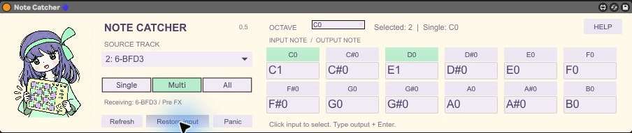

[English](README.md)

# Note Catcher 0.5

別トラックのノートを受信し、入力音ごとに出力音を割り当てます。Rangeは廃止し、複数選択グリッドへ置き換えました。前作Live Bridgeと同じキャラクターを使っています。

[配布ZIPをダウンロード](https://github.com/aoe1928/note-catcher/releases/latest)。Max for Liveが使えるAbleton Liveが必要です。

## 導入

ZIPを展開し、AMXD・note_catcher_routing.js・note_catcher_grid.js・note_catcher_engine.js・bridge-mascot.pngを同じフォルダーに置きます。現時点ではAMXD単体へ内包していません。専用の受信MIDIトラック先頭、音源より前に挿します。送り元へのデバイス挿入やMCP接続は不要です。

## グリッドの操作

Source trackで送り元を選びます。OCTAVEで表示する12音を切り替えます。C-2〜G8の全128音をオクターブ別に設定できます。各マスの上が入力音ボタン、下が出力音の入力欄です。

- **Single**：上のボタンで1つの入力音を選びます。割り当てがあれば変換し、なければ同じ音程で通します。
- **Multi**：複数の入力音をオン／オフします。オクターブをまたいだ選択も可能で、選んだ音だけを通します。
- **All**：全音を通します。設定した音だけ変換し、未設定の音は元の音程のままです。

出力欄をダブルクリックし、C1・C#1・Db1、またはMIDI番号0〜127を入力してEnterで確定します。出力を入力すると、その割り当てが自動でオンになります。Singleではその入力音も選ばれます。誤入力では以前の値を維持します。選択中はミント色です。

Multi／Allで選択中の入力ボタンを押すと、その割り当てを解除します。再びオンにしたときは入力と同じ音程から始まります。OCTAVEを変えても選択は維持します。

**例：Multiにし、C0の下にC1、D0の下にE1を入力。** C0→C1、D0→E1になり、それ以外の入力音は通しません。C0とC1は独立した入力音です。Live表記はMIDI 60＝C3です。

割り当て・モード・Singleの選択音・表示オクターブはLiveのパラメーターとしてセットへ保存します。編集後はセットを保存してください。旧版のRangeはMultiになりますが、旧範囲の選択音への自動移行は行いません。

## ルーティングと制限

受信トラックのMIDI Fromを送り元／Pre FX、MonitorをInへ変更します。送り元の出力は変更しません。1受信トラックにつき送り元は1つで、受信側自身のクリップと合流しません。取り込むのは送り元の音源より前のMIDIで、BFD3の音声や内部グルーブ出力ではありません。ドラムの対応は実際のMIDI番号を確認して手動で設定します。後段のPitchは変換後の音程をさらに移動します。

Refresh：入力状態更新。Restore input：この読み込み中に最初に送り元を選ぶ前の入力を復元。復元用の控えは再読み込みで失われます。デバイス削除／バイパスだけではルーティングは戻りません。Panicは保持音を終了します。循環経路は作らないでください。

ノートのみ対応し、CC・サステイン・ピッチベンド・MPEなどは通しません。ベロシティとチャンネルを維持し、リリースベロシティは正規化します。割り当て・モード・送り元を変えると保持音を止めます。同じチャンネルの同じ出力音へ重なった入力は、最初のノートオンと最後のノートオフにまとめます。保持中の再トリガーはしません。

今回からノートの対応関係を管理するためMIDI処理にMaxのJavaScriptを使用します。サンプル精度の処理ではなく、高負荷時のタイミングは未検証です。

## マニュアル・検証

HELPで簡易ガイドを開けます。[図入り操作マニュアル](Manual.ja.html)。

Windows / Live 11.3.43 / Max 8.5.8で、C0→C1・D0→E1、Multiの未選択除外、Allの未設定通過を実際の後段MIDIで確認しました。ベロシティとノートオフも一致しました。自動テストでは設定変更後の遅いノートオフ、同じ出力音の重なり、チャンネル・端の音程、Single、無効化を検証。[GRID-TEST-RESULTS.json](GRID-TEST-RESULTS.json)を参照。Live 12／macOS、セット全体の再オープン、高負荷時の動作は未検証です。

## 開発

Node.js 18以降で `npm test` を実行するとMIDI処理を検証し、`npm run build` で編集用Maxパッチから未フリーズのAMXDを再生成します。追加パッケージは不要です。3つのJSと画像をデバイスと同じ場所に置いてください。マニュアルはZIP展開後にManual.ja.htmlをブラウザーで開きます。

## ライセンス

独自コード・文書は[MIT](LICENSE)。キャラクター画像と画面画像は対象外です。[元の画像表記](ARTWORK-LICENSE.md)・[素材の扱い](ASSETS-LICENSE.md)を参照してください。
