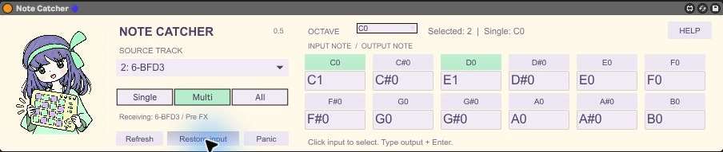

[日本語](README.ja.md)

# Note Catcher 0.5

Receive another Live track's notes and remap each input pitch independently. Range has been replaced by a multiple-selection grid. Uses the same character artwork as Live Bridge.

[Download the release ZIP](https://github.com/aoe1928/note-catcher/releases/latest). Requires Ableton Live with Max for Live.

## Install

Extract the ZIP and keep the AMXD, note_catcher_routing.js, note_catcher_grid.js, note_catcher_engine.js and bridge-mascot.png together. This release is not a frozen single-file device. Insert Note Catcher first on a dedicated MIDI receiver track, before the instrument. No sender or MCP connection is needed.

## Grid

Choose Source track. OCTAVE changes the 12 visible input notes (C-2 through G8, all 128 MIDI notes). Each cell has an input-note button above an editable output note.

- **Single:** click an input button to choose one input note. Its configured output is used, or its original pitch if unassigned.
- **Multi:** click input buttons to enable/disable any collection of notes, including across octaves. Only enabled notes pass.
- **All:** all notes pass; enabled cells are remapped, other notes retain their pitch.

Double-click an output field, type C1, C#1, Db1, or a MIDI number 0–127, and press Enter. Entering an output also enables that mapping. In Single it selects that input. Invalid entries keep the previous mapping. A selected cell is mint. In Multi/All, clicking a selected input clears that mapping; enabling it again starts with the original pitch. Switching octave does not change the selection.

Example: select Multi, enter C1 below C0, and E1 below D0. C0 becomes C1 and D0 becomes E1; all other input notes are dropped. This is octave-specific: C1 is independent of C0. MIDI 60 is C3 in Live.

Mappings, mode, selected single note and visible octave are Live parameters saved with the Set. Save the Set after editing. Existing Range-mode instances become Multi; the old range is not converted into selected cells.

## Routing, sound and limits

The device changes its receiving track's MIDI From to the selected source / Pre FX and Monitor to In. The source's output is untouched. One source per receiving track; receiver clips are not merged. Source MIDI is captured before effects/instrument, not from BFD3 audio or its internal groove generator. Configure drum mappings by actual MIDI note numbers; there is no automatic BFD3-to-AD2 preset. A downstream Pitch effect transposes the mapped output again.

Refresh updates routing. Restore input restores the snapshot taken before the first source selection in this loaded session; that backup does not survive reloading. Removing/bypassing the device does not restore track routing. Panic releases held output notes. Avoid routing loops.

Only notes are processed; CC, sustain, pitch bend, aftertouch, MPE, program changes and SysEx are excluded. Velocity and channel are retained; release velocity is normalized. Editing mappings/mode/source releases held notes. Simultaneous notes targeting the same output pitch/channel merge: only the first note-on is emitted, and the last release ends it (no retrigger while held). MIDI processing now uses Max JavaScript to track note lifetimes; it is not sample-accurate and high-load timing is unverified.

## Manual and verification

HELP opens the Japanese quick guide. [Illustrated Japanese manual](Manual.ja.html).

Windows / Live 11.3.43 / Max 8.5.8: actual downstream MIDI matched C0→C1 and D0→E1 in Multi, with other notes rejected, and All with unassigned notes passed. Velocity and note-offs were checked. Automated tests cover mapping edits with late note-offs, overlapping outputs, channels/boundaries, Single, and disabling. See [GRID-TEST-RESULTS.json](GRID-TEST-RESULTS.json). Live 12/macOS, full Set reopen and heavy-load performance are unverified.

## Development

Node.js 18 or later: `npm test` runs the MIDI engine regression checks; `npm run build` rebuilds the unfrozen AMXD from the editable Max patch. No npm dependencies are required. Keep the three JS files and artwork beside the device. Open Manual.ja.html from the extracted ZIP in a browser.

## License

Original code/docs: [MIT](LICENSE). Character artwork/screenshots are excluded; see [ARTWORK-LICENSE.md](ARTWORK-LICENSE.md) and [ASSETS-LICENSE.md](ASSETS-LICENSE.md). Artwork permissions are separate from the code license.
